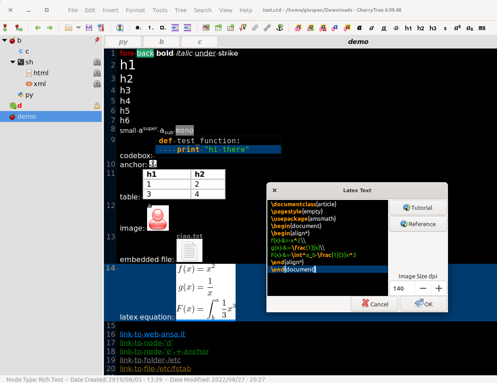

# CherryTree 工作空间增强版 / CherryTree Workspace Enhanced

> **English**: This project is a modified distribution based on [Cherrytree](https://github.com/giuspen/cherrytree)
> by Giuseppe Penone and Evgenii Gurianov, licensed under the GNU GPL-3.0-or-later.
> All modifications in this repository are also released under GPL-3.0-or-later.

## 关于本项目（开源声明）

本项目基于开源项目 **[Cherrytree](https://github.com/giuspen/cherrytree)**（官方主页 [giuspen.net/cherrytree](https://www.giuspen.net/cherrytree/)）修改而来。

- **上游项目**：Cherrytree，Copyright (C) 2009-2025 Giuseppe Penone (giuspen) 及 Evgenii Gurianov (txe) 等上游作者
- **上游许可证**：GNU GPL-3.0-or-later
- **本仓库许可证**：GNU GPL-3.0-or-later（与上游一致，见 [LICENSE](LICENSE) 文件）

依据 GPL-3.0-or-later 许可证，本仓库公开全部修改源代码；原版权声明与许可条款全部保留。
除下述修改部分外，程序功能与上游 cherrytree 1.7.2 一致，上游的功劳和贡献属于原作者。

## AI 辅助声明

本项目的上述修改大部分由 AI 编程助手 **[CodeBuddy](https://www.codebuddy.ai)**（腾讯）辅助完成，
涵盖功能设计、编码、调试与自动化测试；全部改动均由本项目作者审核确认并整合发布。
特此声明，一并致谢。

## 本项目的修改内容（基于 1.7.2）

主界面与工作空间相关增强：

- **主界面 2×2 网格布局**：左列 = 笔记资源树 / 工作空间面板（共用同一条垂直分隔线），
  右列 = 笔记编辑器 / 工作空间浏览器；两条水平分隔线位置实时同步形成整齐十字，
  四个象限互不遮挡；无工作空间内容时下排自动隐藏
- **工作空间面板增强**：
  - 多挂载根文件夹 + 笔记快捷入口（`.ctb` 旁路 sidecar 配置，随文档走）
  - 资源管理器式鼠标悬停阴影高亮（面板树、浏览器列表/图标视图、笔记树）
  - 标题行快捷按钮：新建同级文件夹
  - **四箭头节点移动**：⬆/⬇ 只在同级内调整位置（自定义顺序持久保存，永不自动排序）；
    ⬅ 升级（移出当前文件夹）、➡ 降级（移入上一个兄弟文件夹）——真实改变文件存储位置，
    且始终限制在挂载根文件夹内部
  - 展开状态在移动/刷新后完整保持（GTK 无子行自动折叠问题的完整处理）
  - 文件名递归搜索、双击文件夹展开/折叠、右键菜单（打开/重命名/删除/复制路径等）
  - 文件系统改动实时监视与刷新
- **文件链接插入笔记**：把工作空间内文件/文件夹以链接形式插入当前笔记，点击可跳转

构建方式见 [BUILDING.md](BUILDING.md) 与 `build.sh`（Windows/MSYS2-UCRT64 环境）。

---

# CherryTree

A hierarchical note taking application, featuring rich text and syntax highlighting, storing data in either a single file (xml or sqlite) or multiple files and directories.
The project home page is [giuspen.net/cherrytree](https://www.giuspen.net/cherrytree/).

Written by Giuseppe Penone (aka giuspen) and Evgenii Gurianov (aka txe).

## Features
- Rich text (foreground color, background color, bold, italic, underline, strikethrough, small, h1, h2, h3, h4, h5, h6, subscript, superscript, monospace)
- Syntax highlighting supporting several programming languages
- Images handling: insertion in the text, edit (resize/rotate), save as png file
- Latex math equations rendering
- Embedded files handling: insertion in the text, save to disk
- Multi-level lists handling (bulleted, numbered, to-do and switch between them, multiline with shift+enter)
- Simple tables handling (cells with plain text), cut/copy/paste row, import/export as csv file
- Codeboxes handling: boxes of plain text (optionally with syntax highlighting) into rich text, import/export as text file
- Execution of the code for code nodes and codeboxes; the terminal and the command per syntax highlighting is configurable in the preferences dialog; an embedded terminal is available on linux and mac os
- Alignment of text, images, tables and codeboxes (left/center/right/fill)
- Hyperlinks associated to text and images (links to webpages, links to nodes/nodes + anchors, links to files, links to folders)
- Spell check (using [gspell](https://gitlab.gnome.org/GNOME/gspell))
- Intra application copy/paste: supported single images, single codeboxes, single tables and a compound selection of rich text, images, codeboxes and tables
- Cross application copy/paste (tested with libreoffice and gmail): supported single images, single codeboxes, single tables and a compound selection of rich text, images, codeboxes and tables
- Copying a list of files from the file manager and pasting in cherrytree will create a list of links to files, images are recognized and inserted in the text
- Print & save as pdf file of a selection / node / node and subnodes / the whole tree
- Export to html of a selection / node / node and subnodes / the whole tree
- Export to plain text of a selection / node / node and subnodes / the whole tree
- Toc generation for a node / node and subnodes / the whole tree, based on headers h1, h2, h3, h4, h5, h6 and text sections between headers collapsible
- Find a node, find in selected node, find in selected node and subnodes, find in all nodes
- Replace in nodes names, replace in selected node, replace in selected node and subnodes, replace in all nodes
- Iteration of the latest find, iteration of the latest replace, iteration of the latest applied text formatting
- Import from html file, import from folder of html files
- Import from plain text file, import from folder of plain text files
- Import from basket, cherrytree, epim html, gnote, keepnote, keynote, knowit, mempad, notecase, rednotebook, tomboy, treepad lite, tuxcards, zim
- Export to cherrytree file of a selection / node / node and subnodes / the whole tree
- Password protection (using https://www.7-zip.org/) available only for storage as single file – NOTE: while a cherrytree password protected document is opened, an unprotected copy is extracted to a temporary -folder of the filesystem; this copy is removed when you close cherrytree
- Tree nodes drag and drop
- Automatic link to web page if writing the URL
- Automatic link to node if writing node name surrounded by [[node name]]

## Prebuilt binaries
Prebuilt binaries can be found on [github.com/giuspen/cherrytree/releases](https://github.com/giuspen/cherrytree/releases) and [giuspen.net/cherrytree/#downl](https://www.giuspen.net/cherrytree/#downl).

## How to build from source code
To build from the source code, please read [BUILDING.md](BUILDING.md).

## Localization
The following languages are supported (if you want to help translate to your language, please write me):

– Arabic (ar, Abdulrahman Karajeh)
– Armenian (hy, Seda Stamboltsyan)
– Bulgarian (bg, Iliya Nikolaev)
– Chinese Simplified (zh_CN, Wang Yu)
– Chinese Traditional (zh_TW, Emer Chen)
– Croatian (hr, Filip Bakula)
– Czech (cs, Pavel Fric)
– Dutch (nl)
– English (en, default)
– Finnish (fi)
– French (fr, Francis Gernet)
– German (de, Mr.Update)
– Greek (el, Asterios Siomos)
– Hindi India (hi_IN)
– Hungarian (hu, Stiener Norbert)
– Italian (it, Vincenzo Reale)
– Japanese (ja, Piyo)
– Kazakh (kk_KZ, Viktor Polyanskiy)
– Kazakh (kk_LA, Latin, Viktor Polyanskiy)
– Korean (ko, Sean Lee)
– Lithuanian (lt)
– Persian (fa, Majid Abri)
– Polish (pl, Mariusz Gasperaniec)
– Portuguese (pt, Rui Santos)
– Portuguese Brazil (pt_BR, Raysa Dutra)
– Romanian (ro, Tudor Sprinceana)
– Russian (ru, Viktor Polyanskiy)
– Slovak (sk, Michal Fusatý)
– Slovenian (sl, Erik Lovrič)
– Spanish (es, MP)
– Swedish (sv, Åke Engelbrektson)
– Tamil (ta, TamilNeram)
– Turkish (tr, Ferhat Aydin)
– Ukrainian (uk, Giuseppe Penone)

## Programming with GTKmm3
https://docs.huihoo.com/gtkmm/programming-with-gtkmm-3/3.17.50/en/

## Third party
- Outstanding third party Android project: https://github.com/FFDA/SourCherry
- Enhanced web interface post export to HTML: https://github.com/coregtree/cherrytree-notes-web-interface

## Code Signing Policy
- Free code signing for the Windows binaries provided by [SignPath.io](https://signpath.io/), certificate by [SignPath Foundation](https://signpath.org/)
- This program will not transfer any information to other networked systems unless specifically requested by the user or the person installing or operating it
- Approver: [Giuseppe Penone](https://github.com/giuspen)
